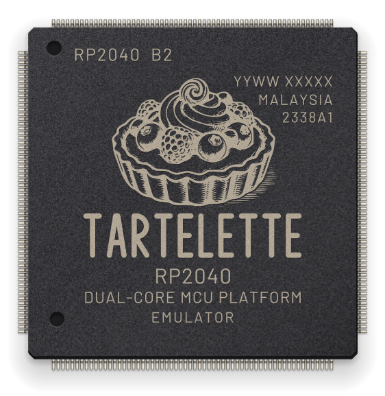
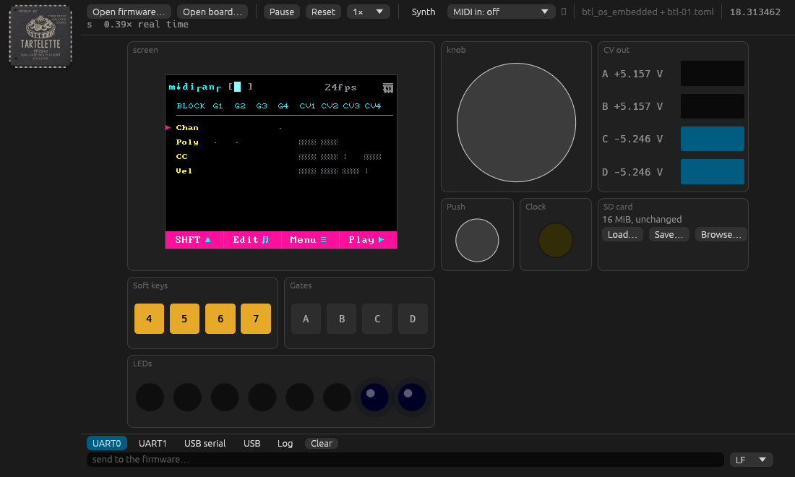
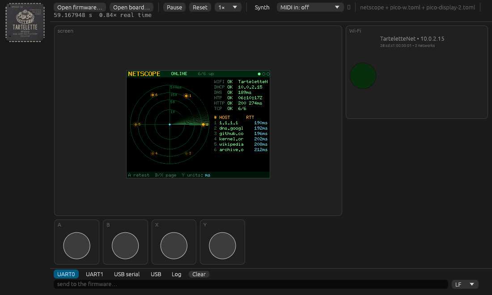

> [!WARNING]
> Much of this project's code was written with LLMs (large language models).
> If that makes it a project you'd rather not use, that's fair: feel free to
> skip it. See the FAQ at the bottom for more information.

<p align="center">
  
</p>

# tartelette

tartelette is an emulator for the Raspberry Pi RP2040 and the board around
it. You give it a firmware (ELF or UF2) and a description of the PCB (a small
TOML file), and it runs the firmware against emulated parts: the screen, the
buttons and knobs, a port expander, a DAC, an SD card, LED strips, the Pico W's
Wi-Fi/Bluetooth chip and the USB port. You get a front panel to poke at, or a
headless runner for scripts and tests.

Right now, there is support for a limited number of peripherals (see
[the list of supported devices](#supported-devices)).


## History

It started as a way to develop firmware for the [BTL-01](boards/btl-01.toml),
a MIDI sequencer / MIDI-to-CV module I've been working on for a few years. After
years maintaining a WASM port which I used to test it, I though I could instead
run it on an emulator. Unfortunately, nothing seemed to be available which let
me also simulate the hardware I'm using, so I decided to use LLMs to create one.
This project doesn't aim to be an exact replica of the actual hardware (although
it seems to do a pretty decent job so far), but rather to allow you to develop your
toy project without having to flash a device every time. Unmodified firmware built
with [Embassy](https://embassy.dev), [rp2040-hal](https://github.com/rp-rs/rp-hal),
[pico-sdk](https://github.com/raspberrypi/pico-sdk) and
[MicroPython](https://micropython.org) runs on it.

<p align="center">
  
  
</p>
<p align="center"><sub>
  Left: the BTL-01 OS. Right: <code>firmware/examples/netscope</code> on a Pico W
  with a Pico Display Pack, pinging real hosts through the emulated Wi-Fi chip.
</sub></p>

## What it does

- Runs both Cortex-M0+ cores, with the RP2040's peripherals: GPIO, PIO, DMA,
  UART, SPI, I2C, USB (device), timer, RTC, flash, the inter-core FIFOs and
  spinlocks. See [docs/rp2040.md](docs/rp2040.md) for what is and isn't
  modelled.
- Emulates the parts on the board from a [board file](docs/boards.md). The
  ones available today are listed below.
- Is deterministic: the same firmware and inputs give the same run, to the
  cycle. That's what makes the headless mode useful for tests.
- Runs natively (Linux, macOS, Windows) or in the browser (WebAssembly).
- Reads the firmware's defmt log over RTT, as a debug probe would.
- Bridges the emulated USB device to your computer: its serial port as a
  real pty, its MIDI interface as MIDI ports, its keyboard as a keyboard.
- Puts the Pico W on your network, through a user-mode NAT, and its
  Bluetooth on mock devices or a real adapter.
- Lets you listen to CV/gate outputs through test oscillators and drums,
  and to audio the firmware plays on a DAC or as PWM through a speaker.

### Supported devices

| Kind | Part | Docs |
|------|------|------|
| `led` | an LED on a GPIO | [led](docs/devices/led.md) |
| `button` | a push button | [button](docs/devices/button.md) |
| `encoder` | a rotary encoder | [encoder](docs/devices/encoder.md) |
| `pot` | a potentiometer, for the ADC | [pot](docs/devices/pot.md) |
| `wav` | a WAV file player, for the ADC | [wav](docs/devices/wav.md) |
| `speaker` | a speaker, on a DAC channel or a GPIO (PWM) | [speaker](docs/devices/speaker.md) |
| `midi` | a MIDI in jack, on a UART or a GPIO | [midi](docs/devices/midi.md) |
| `pcm5102` | TI PCM5102A I2S audio DAC | [pcm5102](docs/devices/pcm5102.md) |
| `mcp23008` | Microchip MCP23008 I2C port expander | [mcp23008](docs/devices/mcp23008.md) |
| `st7789` | Sitronix ST7789 TFT display controller | [st7789](docs/devices/st7789.md) |
| `ssd1306` | Solomon Systech SSD1306 monochrome OLED, on I2C | [ssd1306](docs/devices/ssd1306.md) |
| `ws2812` | WS2812 / SK6812 addressable LEDs | [ws2812](docs/devices/ws2812.md) |
| `dac8165` | TI DAC8165 quad 14-bit DAC | [dac8165](docs/devices/dac8165.md) |
| `sdcard` | an SDHC card in SPI mode | [sdcard](docs/devices/sdcard.md) |
| `cyw43439` | Infineon CYW43439 (Pico W Wi-Fi + Bluetooth) | [cyw43439](docs/devices/cyw43439.md) |

Built-in boards: `pico` (the default), `pico-w` and `btl-01`, plus the
`pico-display-2` shield (Pimoroni Pico Display Pack 2.0).

## Installing

tartelette is written in Rust and builds with a nightly toolchain (the CPU
interpreter uses explicit tail calls). The repository's `rust-toolchain.toml`
selects nightly for you if you have [rustup](https://rustup.rs).

On Linux you also need the ALSA headers for sound and MIDI
(`libasound2-dev` on Debian/Ubuntu, `alsa-lib` on Arch, `alsa-lib-devel` on
Fedora).

From a checkout:

```sh
git clone https://github.com/pferreir/tartelette
cd tartelette
cargo install --locked --path crates/app/tartelette
```

Or straight from git:

```sh
cargo install --locked --git https://github.com/pferreir/tartelette tartelette
```

The board files are compiled into the binary, so `tartelette` works from any
directory. While hacking on it, `cargo run --release -p tartelette -- ARGS`
does the same as `tartelette ARGS`.

### In the browser

The [demo site](https://pferreir.github.io/tartelette/) runs it with no
install, with a few firmware to try. To build the web app yourself:

```sh
rustup target add wasm32-unknown-unknown
cargo install --locked trunk
cd crates/app/tartelette
trunk serve --release
```

Open the page, then open or drop a firmware (and a board file) on it. The web
build needs WebAssembly tail calls: Chrome/Edge 112+, Firefox 121+ or Safari
18.2+. There is no network in the browser, so the Pico W's Wi-Fi scans come
back empty.

A page can open straight onto a firmware: the query string names the files
to fetch at startup, relative to the page.

```text
index.html?firmware=fw.elf&board=my-board.toml&sd=card.img
```

`firmware` and `sd` are URLs (`sd` goes to the board's first SD card);
`board` and `shield` (repeatable) are a built-in name or else a URL; the
files a board from a URL names (a `wav` player's `file`) are fetched relative
to it. `osc`
(repeatable) and `drums` patch the test synth as `--osc` and `--drums` do,
e.g. `&drums&osc=saw:dac.A:expander.4`. Files that fail to load are listed
under Problems. To publish a firmware this way,
copy `trunk build --release`'s `dist/` to any static host and put the files
next to it. `llvm-objcopy --strip-debug` makes the ELF much smaller and keeps
what the defmt log needs.

## Running

Open a window with a firmware on a board:

```sh
tartelette fw.elf                                # a plain Pico
tartelette fw.elf --board pico-w --shield pico-display-2
tartelette fw.elf --board path/to/my-board.toml
```

An ELF is better than a UF2 when you have one: a UF2 has no symbols, so there
is no defmt log. With a window, the firmware and board files reload when they
change on disk, so you can leave tartelette open next to `cargo watch`.

The front panel shows each part of the board as a widget: click buttons, drag
or scroll knobs, load and browse SD cards. Many have keyboard shortcuts set in
the board file. The tabs at the bottom (or on the right) hold the two UARTs,
the USB serial port, the USB traffic log, the firmware's defmt log, the test
synth, SD card browsers and the problems found.

### Headless

```sh
tartelette fw.elf --board my-board.toml --headless --max-cycles 250000000 \
    --press enc_sw@1000000+50000
```

```text
[   13201.5 us] expander pins=16
[   13621.5 us] rgb latch=8
[   14600.0 us] dac dac=147455
...
```

Headless, UART0 goes to stdout and UART1, the board's events and the firmware
log to stderr. `--press` and `--input` script the inputs at given times,
`--dump-screen` saves what is on a display at the end, and `--max-cycles`
stops the run (the core clock is 125 MHz). `tartelette --help` lists every
option, and [docs/running.md](docs/running.md) goes through them: SD card
images, the flash file, faults, the test synth, and so on.

### Some things to try

The demos in `firmware/showcase` build and run from the checkout (you need
the `thumbv6m-none-eabi` target: `rustup target add thumbv6m-none-eabi`):

```sh
cd firmware/showcase

# An arcade game on a Pico with a Display Pack: A/B turn, X thrusts, Y starts
cargo run --release --bin stardust

# A drum machine and bass sequencer: tick Sound on the Synth tab to hear it
cargo run --release --bin groovebox
```

MicroPython runs as it is, from a
[release UF2](https://micropython.org/download/RPI_PICO_W/):

```sh
# MicroPython, with its REPL on the terminal
tartelette RPI_PICO_W-v1.29.0.uf2 --headless

# ... or as a serial port that mpremote can talk to (Linux)
tartelette RPI_PICO_W-v1.29.0.uf2 --usb-bridge serial --usb-tty-link /tmp/ttyACM
mpremote connect /tmp/ttyACM
```

`firmware/showcase` also has an LED matrix and a shell (see its
[README](firmware/showcase/README.md)). `firmware/examples` has Pico W
firmware that runs both here and on real hardware (Wi-Fi, Bluetooth, USB and two apps for the Pico Display Pack). Their
`cargo run` starts them in tartelette; see
[firmware/README.md](firmware/README.md).

## Documentation

- [Running tartelette](docs/running.md): the command line, headless runs,
  SD cards, flash, faults and the test synth
- [Board files](docs/boards.md): describing a PCB, the front panel and shields
- [The RP2040 model](docs/rp2040.md): the CPU and each on-chip peripheral
- [USB](docs/usb.md): the emulated host, the console and the bridges
- [Devices](docs/devices/): one page per part kind
- [Development](docs/development.md): the crates, tests, the web build and
  PGO builds
- [Firmware](firmware/README.md): the example and test firmware

## Project layout

```
crates/
  core/                  the chip, deterministic and I/O-free
    armv6m/              the Cortex-M0+ core: CPU, NVIC, SysTick, SCB
    rp2040-core/         the chip: memory map, peripherals, ELF/UF2 loading
    usbhost/             the USB host on the other end of the cable
  board/                 what is around the chip, deterministic and I/O-free
    pcb/                 the device framework and board-file parser (chip-agnostic)
    pcb-devices/         the device models
    sdimage/             SD card images: FAT formatter and reader
  host/                  the host's side
    bridge-net/          user-mode network for the Wi-Fi chip
    bridge-hci/          a real Bluetooth adapter behind the emulated chip (Linux)
    bridge-usb/          USB serial as a pty, HID through uhid (Linux)
    rtt/                 defmt-over-RTT log reader
  app/
    tartelette-runtime/  running firmware on a board, without a UI
    tartelette/          the app: front panel (native and web) and headless runner
tools/                   CPU differential tests, docs renderer, web benchmark
boards/                  board and shield files, and their JSON schema
firmware/                example firmware and the emulator's test firmware
scripts/                 PGO build, browser checks, MicroPython's test suite
```

The emulator crates are `no_std` + `alloc` and do no I/O, so the same core
runs natively and in WebAssembly. More in
[docs/development.md](docs/development.md).

## Status

tartelette runs everything I have thrown at it so far, but it is a young
project and parts of the chip are missing. Most notably the watchdog and
the interpolators are not modelled, and nothing is
cycle-accurate with respect to bus contention. If your firmware does
something the emulator gets wrong, a minimal firmware that shows it is the
most useful bug report.

## Testing

```sh
cargo test --workspace
```

The end-to-end tests build the firmware in `firmware/tests` and run it
headless. `cpu-difftest` takes about a minute. See
[docs/development.md](docs/development.md) for the browser checks and
MicroPython's test suite.

## Contributing

Contributions are welcome: see [CONTRIBUTING.md](CONTRIBUTING.md). Pull
requests should be small and focused, and while the code may be written
with LLMs, descriptions and discussion must be your own words.

## License

tartelette is licensed under the GNU GPL v3 (see [LICENSE](LICENSE)).

The RP2040 bootrom image in `crates/core/rp2040-core/bootrom/` is
© Raspberry Pi (Trading) Ltd and is distributed under its own BSD-3-Clause
license (see the [README](crates/core/rp2040-core/bootrom/README.md) there).

Raspberry Pi, RP2040 and Pico are trademarks of Raspberry Pi Ltd. Pimoroni
and Infineon are trademarks of their respective owners. tartelette is an
independent project and is not affiliated with, endorsed by or sponsored by
Raspberry Pi Ltd or any other company named here.

## FAQ

### Was this project vibecoded?

Yes, mostly. It was vibecoded by someone experienced in embedded software
development and thus who knows (more or less) what they're doing, but I would
be lying if I said I wrote most of the code myself.

### Do you think it is ethical to use LLMs in software development?

I think it can be ethical, as long as it is done with the right intent and
in the right way. Pretty much like everything else.

### Don't LLMs just regurgitate code stolen from FOSS developers?

FOSS has always been a big tent sheltering FSF libertarians and corporate Open Source
types. While I do not agree with the closed nature of the current LLM landscape
(especially as it concerns the so-called “frontier models”), I would be lying if I
said that I view using LLMs in software development as nefarious by definition. On
the contrary - to me, FOSS has always been about making knowledge and tools accessible
to everyone, and this technology has the potential to make software development more
accessible than ever and to empower users with the means to find the solutions to their
problems. I've always shared my code with the intent of seeing it used by someone else.
Granted, there are rent-seekers taking advantage of this shared corpus of information right
now, and I am hoping that open-weight models and local inference will soon give us a way out.

### Why not develop Tartelette without LLMs?

Let's put it like this: if I had no access to an LLM, this project wouldn't exist, as I
don't have the time to develop anything of the sort using traditional methods. To me,
this is a net positive.

### What about the environmental impact of AI/LLMs?

It's a legitimate concern. I confess it's the one I worry about most. On the other
hand, writing code seems to me like one of the highest-legitimacy uses of scarce
compute power. If we were to impose boundaries on LLM usage, we should worry
about video generation first, for which 99% of use cases are useless, illegal or
both. I understand that my neighbor using ChatGPT to generate cat videos doesn't
offset my own CO₂ footprint, but I hope you'll understand that opinions can be nuanced.

### Don't LLMs take the fun out of programming?

Yes, in a way. On the other hand, you can be much more ambitious in your own engineering
projects or spend time in other hobbies.

Developing an emulator from scratch isn't my definition of fun (well, it kind of is, but in
this case, the emulator is a dependency rather than my "main" project). Hence, I prefer to
spend my time developing Eurorack modules, playing with the electronics and writing actual
firmware (with or without LLM help).