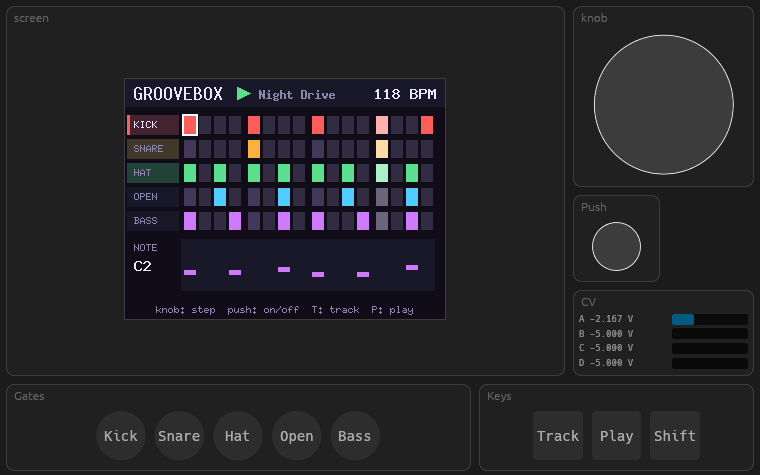
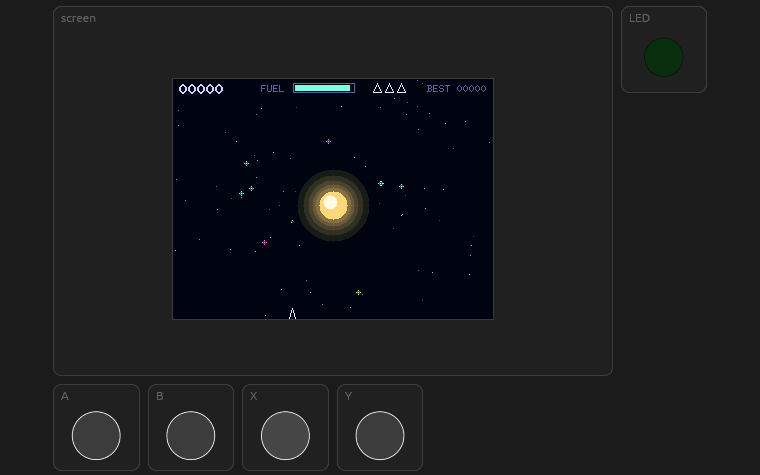
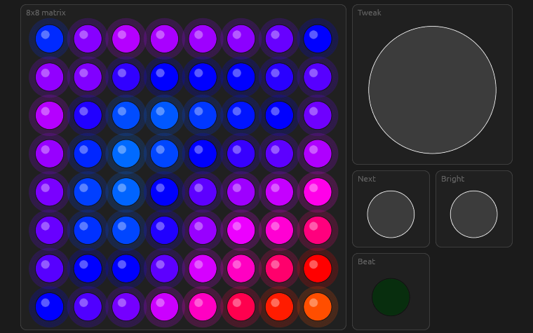
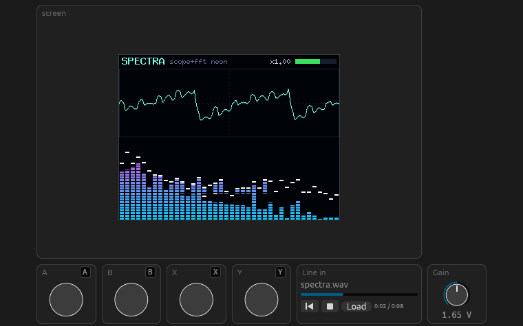
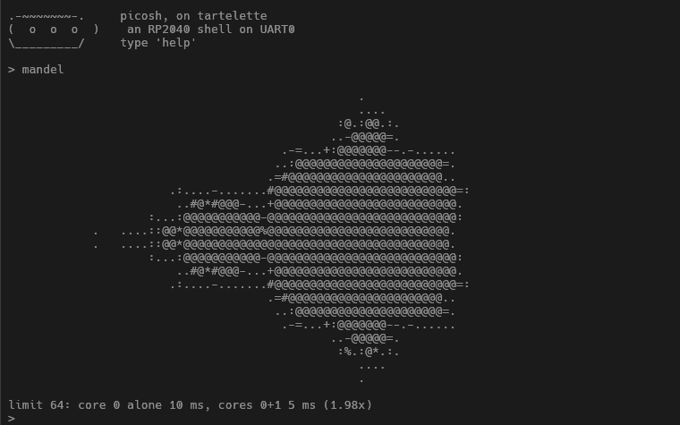
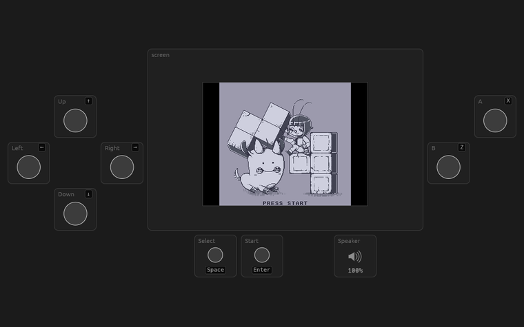
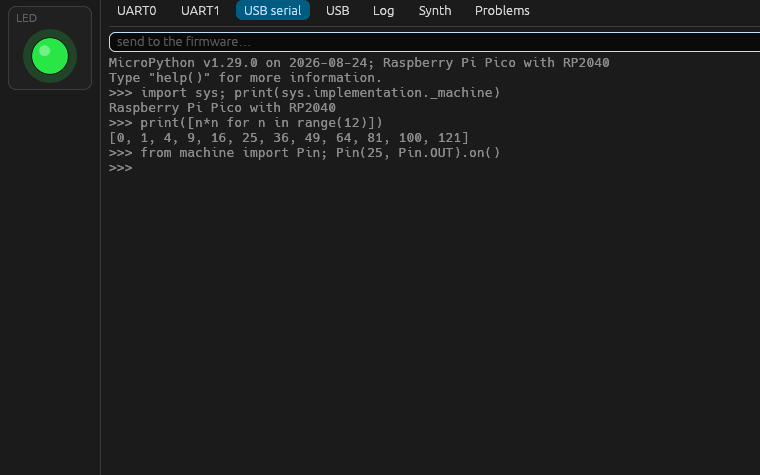

<!--
The demo site's landing page. tools/sitedocs turns it into index.html
(scripts/build-site.sh runs it), with these conventions:

- The paragraph right after the title, in italics, is the subtitle.
- A `##` section with `###` entries is a list of demos. In each entry, an
  image is its screenshot, a list of "Label: value" items becomes the
  details (inline code there shows as keys), and the last paragraph of
  links is its actions: the first link is the Run button.
- Any other `##` section has its text on the left and its code on the
  right. A quote in it is shown as small print.
- What follows the closing horizontal rule is the footer.
- `{{NAME}}` is replaced by the build (REPO_URL, MICROPYTHON_VERSION), and
  an entry between the micropython (or picodexed, varvara) comments is
  dropped when the build has no MicroPython (or picodexed, a Varvara ROM).

Links are written relative to this file, so they work on GitHub too.
-->

# Tartelette

*Test your RP2040 projects on an emulator with simulated hardware*

tartelette emulates a Raspberry Pi RP2040 together with whatever is soldered
to it. You hand it a firmware and a short TOML file describing the PCB, and it
wires the firmware up to emulated displays, knobs, LEDs, DACs, port expanders
and SD cards.

The demos below are normal firmware images, built for real hardware. Nothing
was changed to make them run here. Click the panel's buttons and knobs, or use
the keys listed with each one. [Or start with an empty emulator.](emu/)

To try your own firmware, read about [board files](../docs/boards.md) and
[the parts you can put on them](../docs/devices/).

## Demos

### Groovebox



Drum machine and bass line, 16 steps. The gates and the pitch CV come out of
the board as voltages, and tartelette's test synth turns them back into sound:
kick, snare and hats from the expander, a saw wave tracking the DAC. Switch
**Sound** on in the toolbar.

- Board: custom: ST7789, MCP23008, DAC8165, encoder
- Uses: I2C · SPI+DMA · PIO encoder · bit&#8209;banged DAC · 2 async tasks
- Keys: `←` `→` move, `Space` step on/off, `T` track, `P` play, `S`+knob tempo

[Run](emu/?firmware=../demos/groovebox.elf&board=../demos/groovebox.toml&drums&osc=saw:dac.A:expander.bass)
[groovebox.rs](../firmware/showcase/src/bin/groovebox.rs)
[groovebox.toml](../firmware/showcase/boards/groovebox.toml)

### Stardust



You're in orbit around a star. Collect the dust for points and fuel, and
either avoid the comets or blast them apart with a pulse. It redraws at 25 fps
and only pushes the parts of the screen that changed over SPI.

- Board: pico + pico-display-2 shield
- Uses: SPI+DMA · strip rendering · soft-float physics
- Keys: `A` `B` turn, `X` thrust, `Y` pulse / start

[Run](emu/?firmware=../demos/stardust.elf&board=pico&shield=pico-display-2)
[stardust.rs](../firmware/showcase/src/bin/stardust.rs)

### Lumen



Light patterns on an 8×8 WS2812 matrix: plasma, fire, rain, Game of Life,
ripples, fireflies. The emulator reads the LED colours out of the PIO's pulse
timings, the same way the real LEDs do.

- Board: custom: 64 × WS2812, encoder, buttons
- Uses: PIO WS2812 · PIO encoder · DMA · UART
- Keys: `Space` next scene, `←` `→` adjust, `B` brightness

[Run](emu/?firmware=../demos/lumen.elf&board=../demos/lumen.toml)
[lumen.rs](../firmware/showcase/src/bin/lumen.rs)
[lumen.toml](../firmware/showcase/boards/lumen.toml)

### Spectra



An oscilloscope and spectrum analyser listening to a song. The song is a WAV
file played into the RP2040's ADC as a voltage. The ADC samples the line input
and a gain knob in round robin, DMA moves the samples while the screen is
drawn, and a fixed-point FFT turns them into 40 bands, or a waterfall.

- Board: custom: line in, gain knob + pico-display-2 shield
- Uses: ADC round robin+DMA · fixed-point FFT · SPI+DMA · strip rendering
- Keys: `A` view, `B` freeze, `X` peaks, `Y` colours; drag the knob for gain

[Run](emu/?firmware=../demos/spectra.elf&board=../demos/spectra.toml&shield=pico-display-2)
[spectra.rs](../firmware/showcase/src/bin/spectra.rs)
[spectra.toml](../firmware/showcase/boards/spectra.toml)

### picosh



A little shell on UART0. It can draw the Mandelbrot set on one core and then
on two (compare the times), dump the bootrom, find primes and blink the LED.

- Board: pico
- Uses: UART · both cores · interrupts
- Try: in the UART0 tab, `help` `mandel` `peek 0` `blink 3`

[Run](emu/?firmware=../demos/picosh.elf&board=pico)
[picosh.rs](../firmware/showcase/src/bin/picosh.rs)

<!-- varvara -->
### Varvara



A [Uxn/Varvara](https://wiki.xxiivv.com/site/varvara.html) virtual machine
running [fourtette](https://github.com/nf/fourtette), a block game by nf
(Apache-2.0), from its release ROM. The interpreter, the two-layer screen and
the four-voice audio run on the Pico at 200 MHz, 60 frames a second. Switch
**Sound** on in the toolbar for the music.

- Board: custom: ST7789, D-pad, A, B, Select, Start, speaker
- Uses: overclocking · SPI+DMA · PWM audio+DMA · UART console
- Keys: arrows move, `X` `Z` rotate, `Space` hold, `Enter` start

[Run](emu/?firmware=../demos/varvara.elf&board=../demos/varvara.toml)
[varvara/](../firmware/showcase/src/bin/varvara/main.rs)
[varvara.toml](../firmware/showcase/boards/varvara.toml)
[fourtette's licence](demos/fourtette.LICENSE.txt)
<!-- /varvara -->

<!-- micropython -->
### MicroPython



The stock RPI_PICO build of MicroPython {{MICROPYTHON_VERSION}}, downloaded
from micropython.org as is. The REPL lives on the emulated USB serial port;
open that tab and type:

```python
from machine import Pin
Pin(25, Pin.OUT).on()
```

- Board: pico
- Uses: USB device · UF2 · flash filesystem

[Run](emu/?firmware=../demos/micropython.uf2&board=pico)
[micropython.org](https://micropython.org)
<!-- /micropython -->

<!-- picodexed -->
### picodexed


[picodexed](https://github.com/diyelectromusic/picodexed), a DX7-style FM
synth on the Dexed engine, as its author builds it: the prebuilt UF2,
downloaded as is. It overclocks to 250 MHz, plays 16 voices at 24 kHz into a
PCM5102 over PIO I2S, and shows the voice on an SSD1306 OLED. Switch
**Sound** on in the toolbar, give it about five seconds to start, then play
the keys, or a MIDI keyboard through **MIDI in…**. The knob picks the voice.

- Board: custom: SSD1306, PCM5102, MIDI in, encoder
- Uses: overclocking · PIO I2S + DMA · both cores · I2C · UART MIDI
- Keys: click the keyboard; `←` `→` voice

[Run](emu/?firmware=../demos/picodexed.uf2&board=../demos/picodexed.toml)
[picodexed.toml](../firmware/showcase/boards/picodexed.toml)
[github.com/diyelectromusic/picodexed](https://github.com/diyelectromusic/picodexed)
<!-- /picodexed -->

## Running locally

The native build can do a few things a browser can't: put the Pico W on your
real network, talk to Bluetooth, expose the USB serial port as a tty, and show
up as a MIDI device. [How to run it](../docs/running.md).

> In the browser you need WebAssembly tail calls: Chrome/Edge 112+, Firefox
> 121+ or Safari 18.2+. The tabs under the panel hold the UARTs, USB serial,
> the firmware log and the synth.

```sh
cargo install --locked --path crates/app/tartelette
cd firmware/showcase
cargo run --release --bin groovebox    # groovebox-audio, stardust, lumen, spectra, picosh
cargo run --release --bin stardust -- \
    --headless --log --max-cycles 1000000000
```

---

Runs firmware built with Embassy, rp2040-hal, the Pico SDK and MicroPython. A
lot of tartelette's code was written with AI assistance.

Raspberry Pi, RP2040 and Pico are trademarks of Raspberry Pi Ltd. tartelette
is an independent project, not affiliated with or endorsed by Raspberry Pi
Ltd.
